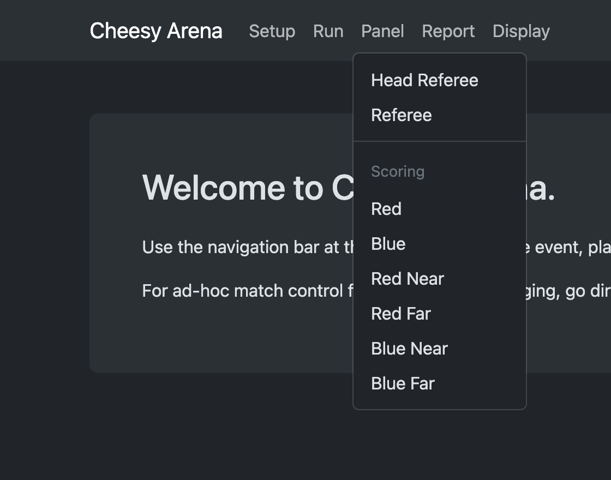
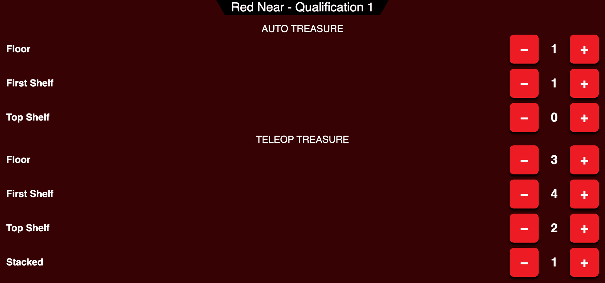
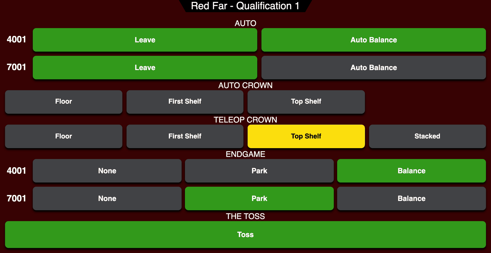
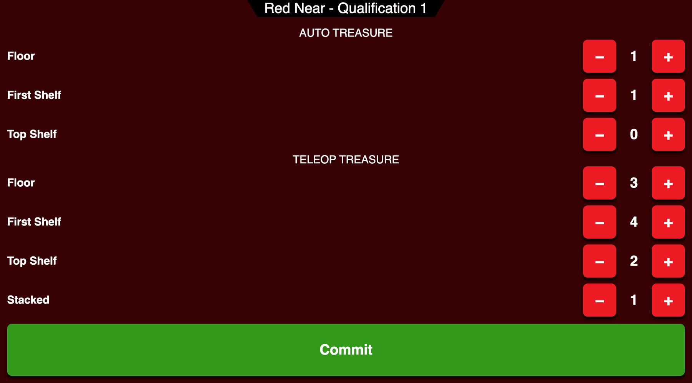

# Medieval Mayhem Scorer Manual

Thank you for volunteering to be a scorer!  It's a lot of fun!  Here are some instructions for how to use the FMS' scoring panels to score a match.

Each alliance has two scorers:

- **Near scorer:** the treasures, by level.
- **Far scorer:** everything else: each robot's leave, auto balance and endgame, the crown, and the toss.

The head referee posts the score once both scorers on both alliances have committed.

## Before the event

1. Connect the tablet to the field Wi-Fi. The FMS operator will give you the SSID and WPA Key.
2. Open the FMS in Chrome (or Safari on an iPad) at `http://10.0.100.5:8080`, then choose your page from the
   **Panel** menu, under **Scoring**:

   

   Or type its address:

   | You are | Page |
   |---|---|
   | Red near scorer | `http://10.0.100.5:8080/panels/scoring/red_near` |
   | Red far scorer | `http://10.0.100.5:8080/panels/scoring/red_far` |
   | Blue near scorer | `http://10.0.100.5:8080/panels/scoring/blue_near` |
   | Blue far scorer | `http://10.0.100.5:8080/panels/scoring/blue_far` |

   If the operator asks one person to score a whole alliance, choose **Red** or **Blue** instead: it shows both halves
   on one page.
3. \[Optional\] **Add to Home Screen** in the browser menu so the page opens full screen like an app.
4. Check the title at the top, for example "Red Near - Qualification 3": it names your alliance, your side and the
   match that is loaded.

The buttons stay grey until the match starts.

## Near scorer: treasures

- **Auto treasure:** tap **+** for each treasure scored during autonomous, under the level it is on: Floor, First
  Shelf or Top Shelf.
- **Teleop treasure:** the same for the rest of the match, plus **Stacked**.
- Tapped one too many? Tap **−**.
- Do not count the crown. The far scorer enters it.

## Far scorer: robots, the crown and the toss

Each robot has its own row, labelled with its team number.

- **Leave:** tap when the robot earns Leave in autonomous.
- **Auto Balance:** tap when the robot earns Auto Balance. This also turns on Leave.
  (If for some reason that is not the case, tap Leave to turn it off).
- **Crown:** tap where the crown ends up: under **Auto Crown** if it was placed during autonomous, otherwise under
  **Teleop Crown**. There is only one crown; tapping another spot moves it, and tapping the lit spot clears it.
- **Endgame:** at the end of the match, choose **None**, **Park** or **Balance** for each robot.
- **The Toss:** tap when the alliance you're scoring tosses the treasure into the target.

## After the match

1. When the match ends, a green **Commit** button appears.
2. Check your entries and fix anything that is off.
3. Tap **Commit**. The page locks until the next match is loaded.

If you notice a mistake after committing, tell the head referee right away. Before the score is posted they can wait
for the FMS operator to fix it; after it is posted, the operator can still correct it in Match Review.

## Points, for reference

| Element | Auto | Teleop |
|---|---|---|
| Floor treasure | 4 | 2 |
| First Shelf treasure | 8 | 5 |
| Top Shelf treasure | 12 | 10 |
| Stacked treasure | | 8 |
| Crown | twice the treasure value of its spot | twice the treasure value of its spot |
| Leave, per robot | 4 | |
| Auto Balance, per robot | 12 | |
| Park / Balance, per robot | | 2 / 12 |
| The Toss | | 2 |
